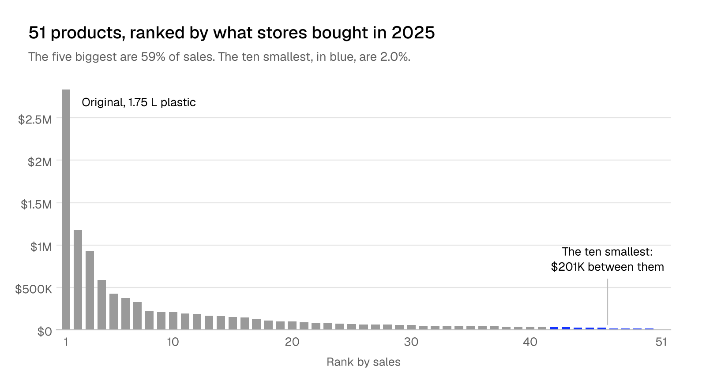
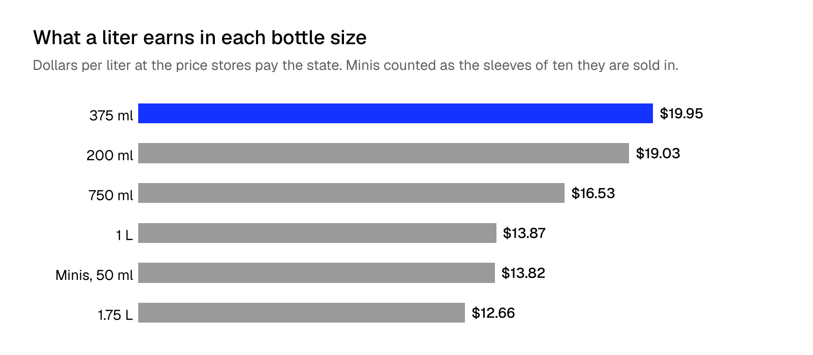
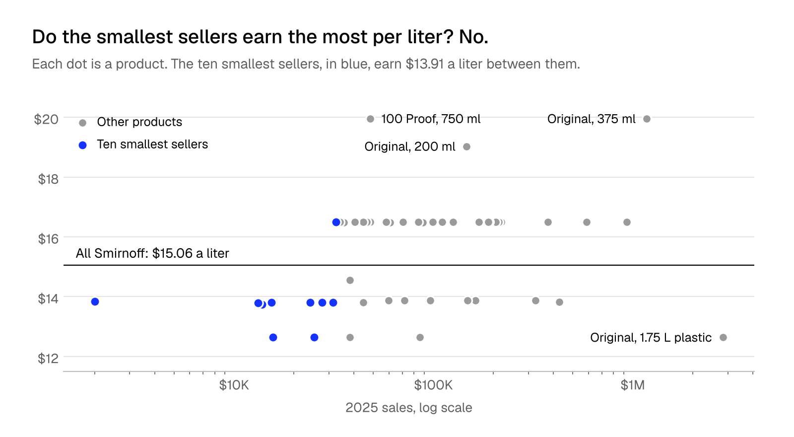
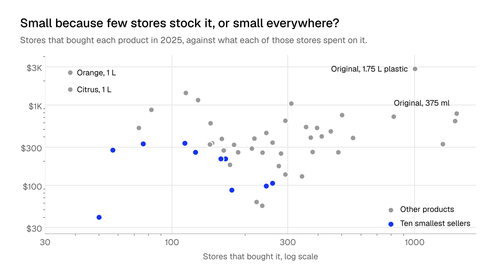
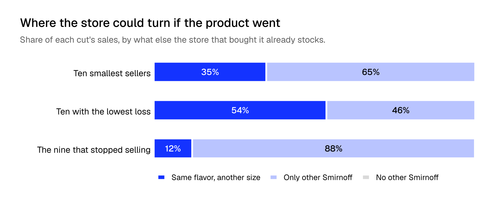
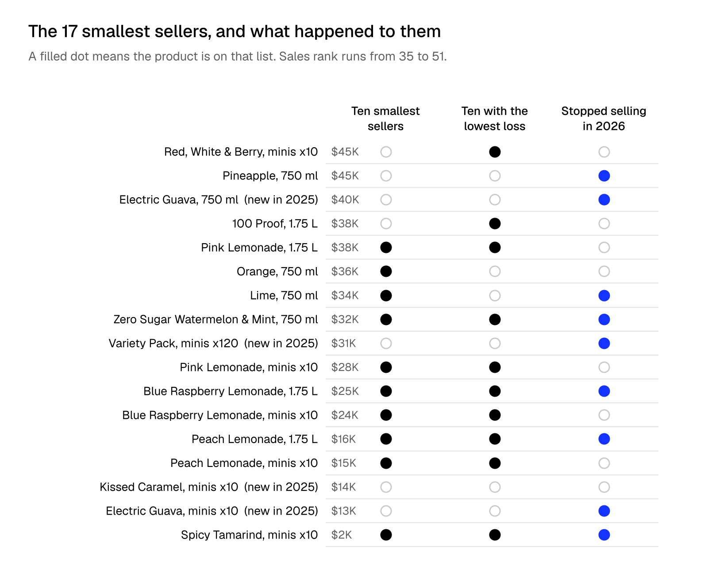

# Cutting products without cutting margin

There is a common piece of advice about trimming a product range: do not just cut whatever sells least, because the small sellers are often the ones that earn the most per unit. I went in expecting to show it on real data. I took a real brand's sales, worked out which ten products I would cut, and then checked against what the following year actually did.

It did not go the way I expected. On this data, cutting the smallest sellers was close to the right call, and the careful method I built barely beat it.

Everything below can be rerun from [analysis.ipynb](analysis.ipynb).

## The data

Iowa is one of the states where the state itself is the liquor wholesaler. Every bottle a shop, supermarket or gas station sells was first bought from the state's warehouse, and the state publishes each of those purchases. I used:

- every purchase of a Smirnoff product by an Iowa store in 2025: 77,466 invoice lines from 2,095 stores, covering 51 products and $10.1 million (up from $9.0 million in 2024)
- product totals for 2024, and for 2026 through October 30
- the state's product list, for pack sizes and prices

Source: Iowa Department of Revenue, Alcoholic Beverages Division, through the [Iowa Data Hub](https://data.iowa.gov), licensed CC BY 4.0. [get_data.py](get_data.py) rebuilds the files in `data/` from the state's downloads.

I picked Smirnoff because it has many flavors and many bottle sizes, which is what makes a range hard to trim. I have no connection to Smirnoff or its owner, and nothing here is their view or their decision.

Two things this data cannot tell you:

- **What shoppers paid.** A "sale" here is a store buying from the state.
- **What the producer earns.** There is no cost of making the product. The state adds the same 50% to every Smirnoff product on its list, so the state's own margin is a third of the price on all of them. For the margin question I used the nearest real signal: what a liter earns in each bottle size.

## Step 1. Draw the obvious line



One product, the 1.75 liter plastic bottle of the original vodka, is 28% of sales on its own. The five biggest are 59%. The smaller-selling half of the range, 26 products, is 9.6%.

The ten smallest add up to $201K, or 2.0%. That is the obvious cut, and the question is whether it is a bad one.

## Step 2. Check what a "bottle" is

The sales file has a liters column. Divide sales by it and the 50 ml minis earn $158 a liter, more than seven times anything else in the range. Most of the smallest sellers are minis. That would have been my whole story: the small sellers earn the most, so do not cut them.

It is wrong. The state's product list shows that minis are sold in sleeves of ten. One "bottle" in the sales file is ten little bottles, 500 ml, and the liters column counts it as 50 ml. Counted properly, minis earn $13.82 a liter, about the same as the 1 liter bottle.

I came close to building the analysis on that number.

## Step 3. See what a liter earns



| Size | Per liter |
|---|---:|
| 375 ml | $19.95 |
| 200 ml | $19.03 |
| 750 ml | $16.53 |
| 1 L | $13.87 |
| Minis | $13.82 |
| 1.75 L | $12.66 |

The same vodka earns 58% more per liter in a 375 ml bottle than in a 1.75 liter one. A small bottle also costs more per liter to fill and pack, and I do not have that cost, so this is a stand-in for margin and not margin.

If the advice held here, the smallest sellers would be the high earners.



They are not. The ten smallest sellers earn $13.91 a liter between them, against $15.06 for the brand as a whole. The best-paying sizes are the 375 ml and 200 ml bottles of the original vodka, which rank 2nd and 16th by sales. Cutting the ten smallest would nudge the brand's average price per liter up.

## Step 4. Set aside what one year cannot judge

Four products launched during 2025 and had no 2024 sales: Electric Guava in 750 ml and in minis, Kissed Caramel minis, and a variety pack of minis. One more, Peppermint Twist, only sells from August to December. A full-year total undersells all five, so I took them out of the running.

That leaves 46. The ten smallest of those add up to $250K, or 2.5%.

## Step 5. Few stores, or slow everywhere?



A product can be small because few stores stock it. Orange in the 1 liter bottle was bought by 38 stores, and each spent $2,540 on it in the year. Only the big bottle of the original does better per store. Orange 1 liter ranks 20th overall.

None of the ten smallest is like that. They were bought by between 50 and 259 stores, and each store spent $40 to $337 on them. So at ten products this step changes nothing. It would start to matter with a deeper cut: by 25 products, sales rank would be removing things like Citrus 1 liter, which is small for the same reason Orange is.

## Step 6. Ask where the buyer goes

For every store that bought a product, I looked at what else that store stocks. If it carries the same flavor in another size, some of the demand can stay. If it carries only other Smirnoff products, less of it will. If it carries nothing else from the brand, the sale is gone.



Then I chose ten products a second way: one at a time, always the product that adds the least estimated loss. That list keeps 8 of the same ten. It swaps out Lime and Orange in 750 ml, which most stores carry in that one size only, for the 1.75 liter bottle of 100 Proof and the Red, White & Berry minis, which are extra sizes of flavors that would stay.

Estimated dollars lost per year, under three assumptions about how much demand stays with the brand:

| | Nothing moves | Some moves | Most moves |
|---|---:|---:|---:|
| Ten smallest sellers | $250K | $158K | $88K |
| Ten with the lowest loss | $263K | $145K | $62K |
| The nine that really stopped selling | $239K | $174K | $116K |

"Some moves" means half the liters stay when the store has the same flavor in another size, and a quarter stay when it only has other Smirnoff. "Most moves" is 80% and 50%. These rates are my assumptions. The share of each list that has a same-flavor option is real: 35% for the smallest sellers, 54% for my list, 12% for the nine that went.

My list saves $13K a year if some demand moves and $27K if most of it moves. If nothing moves, it loses $13K more. On a brand that sells $10.1 million in the state, that is the size of the difference between the careful cut and the lazy one.

## What actually happened

I have 2026 sales through October 30. Nine of the 51 products had no sale after February. Together they were $239K, or 2.4%, of 2025 sales.



- **Sales rank found them.** All nine ranked 36th or lower. The plain ten smallest sellers from Step 1 had six of the nine.
- **My method did worse.** Of the six that were old enough to judge, sales rank had five and my list had four.
- **The launches I set aside did not last.** Three of the four products launched in 2025 were gone within a year. I had called them too new to judge.
- **Flavors went and sizes stayed.** Lime, Pineapple and Zero Sugar Watermelon & Mint disappeared. Most of the minis I would have cut are still selling. That is the opposite of what my loss estimate preferred, which is why the nine cost more in the table above than either list of ten as soon as any demand is assumed to move.

I do not know who made these calls or why. A product can stop selling in Iowa because the brand dropped it, because the state delisted it, or because supply ran out. Four new products also appeared in 2026, so the range did not simply shrink.

## What I take from it

1. **Test the belief before building on it.** The advice I started with was not true of this brand in this state. The small sellers were not the high earners, and the whole tail was 2% of sales.
2. **Check the units first.** The minis figure was wrong by a factor of ten and pointed straight at the conclusion I was hoping for.
3. **Sales rank is a fair first list.** Where it needs help is new products, products held back by distribution, and deeper cuts than ten.
4. **Lost sales is not the only thing a cut is for.** My estimate had no value for a simpler range. Whoever removed three whole flavors seems to have been solving for that, and I cannot price it from this data.

## Limits

- One brand, one state, one year. Iowa's state-run system is unusual.
- These are store purchases from the state, not shopper purchases.
- There are no producer costs. Price per liter is a stand-in for margin.
- The rates in Step 6 are assumptions, and they treat a mini and a 750 ml bottle of the same flavor as substitutes. The fact that the minis survived suggests they are not.
- I had seen which products stopped selling before I finished the method, so the comparison is not a blind test.
- "Stopped selling" is what the data shows. It does not show a decision.

## Files

```
README.md                 this write-up
analysis.ipynb            the notebook, with every number and chart
cuts.py                   the calculations
charts.py                 draws the six charts
get_data.py               rebuilds data/ from the State of Iowa's downloads (about 1.7 GB)
data/lines_2025.csv       77,466 Smirnoff invoice lines, 2025
data/by_product_2024.csv  product totals, 2024
data/by_product_2026.csv  product totals, 2026 through October 30
data/product_list.csv     the state's product list for the brand
test_cuts.py              20 test functions: the calculations by hand, then this page against the data
```

To rerun:

```
pip install -r requirements.txt
python cuts.py
python charts.py
pytest
```

`cuts.py` is written around one brand. To try another, change `BRAND` in `get_data.py`, rerun it, and replace the flavor names in `flavor_of`.

Data: Iowa Department of Revenue, Alcoholic Beverages Division, "Iowa Liquor Sales" and "Iowa Liquor Products", Iowa Data Hub, CC BY 4.0. Extracted November 17, 2026.
